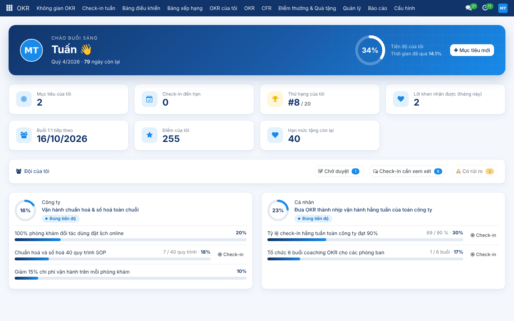
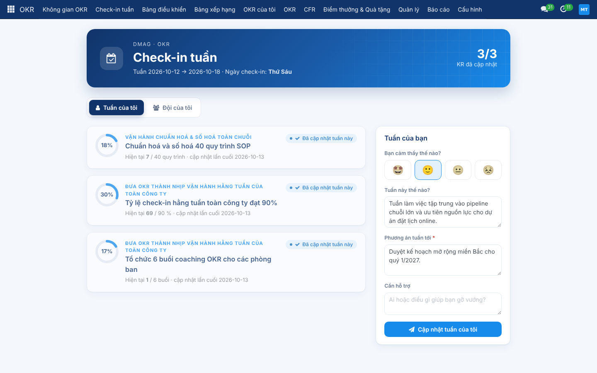
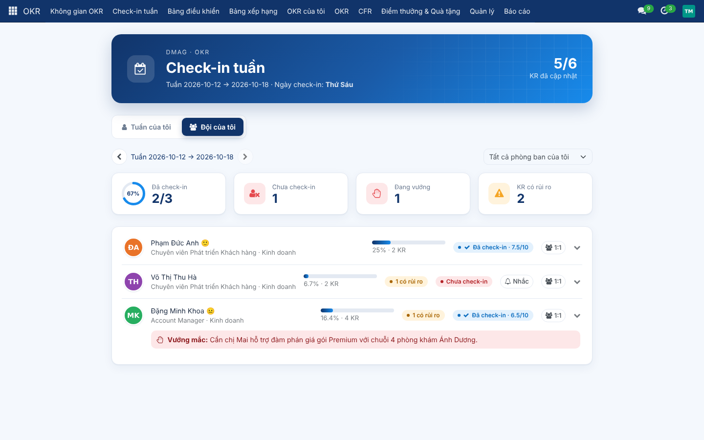
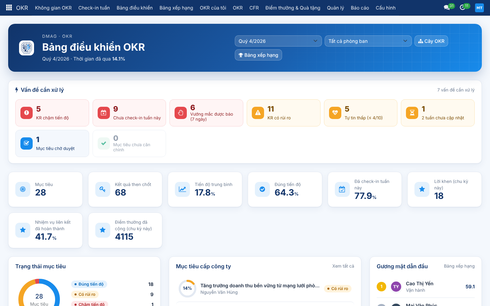
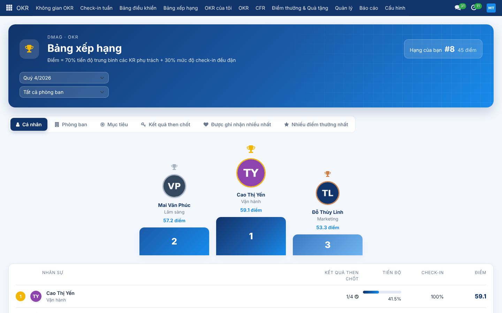
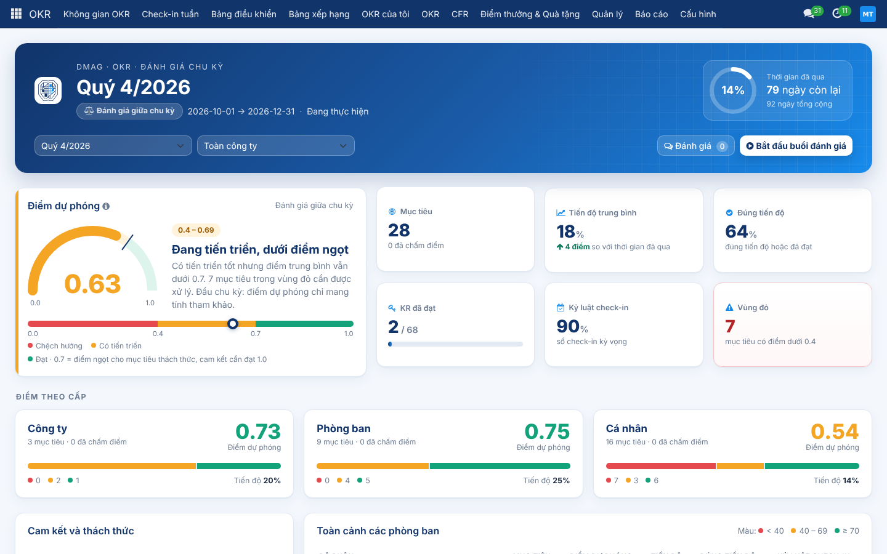
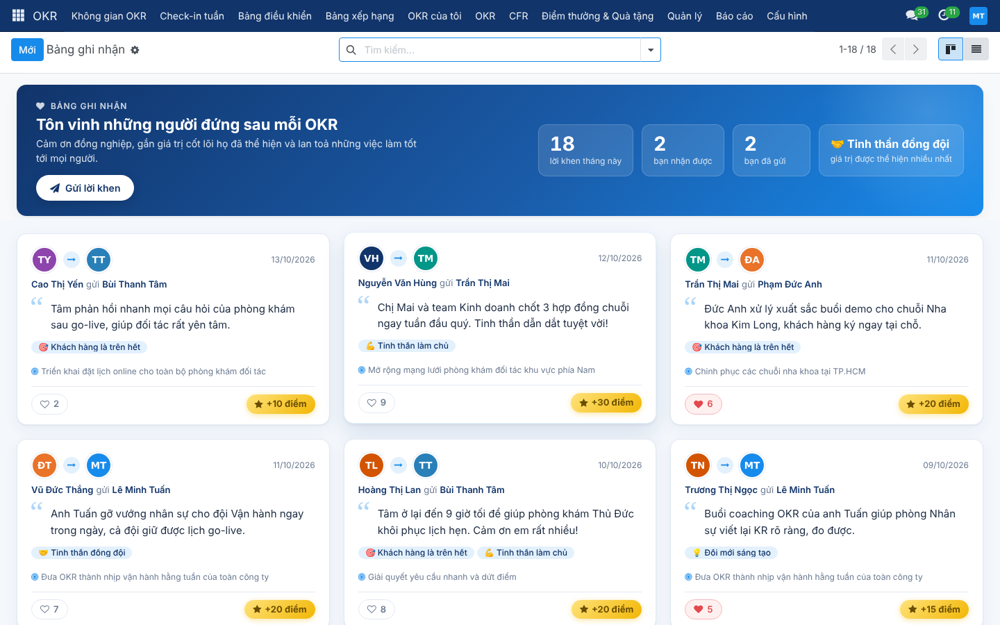
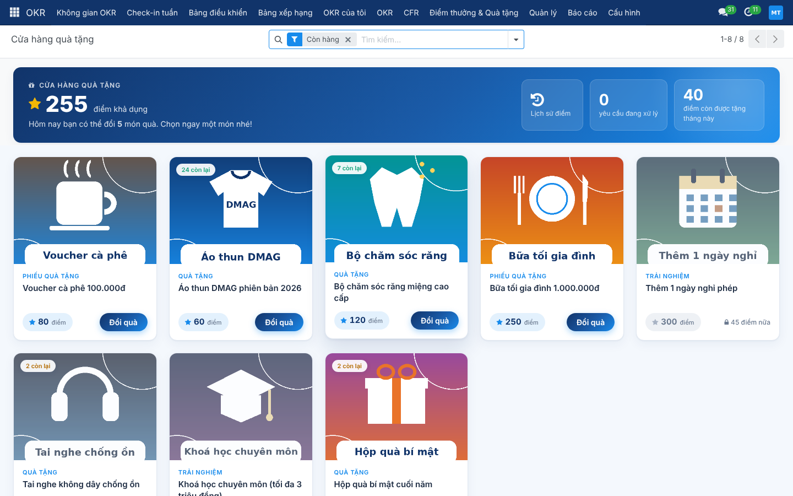
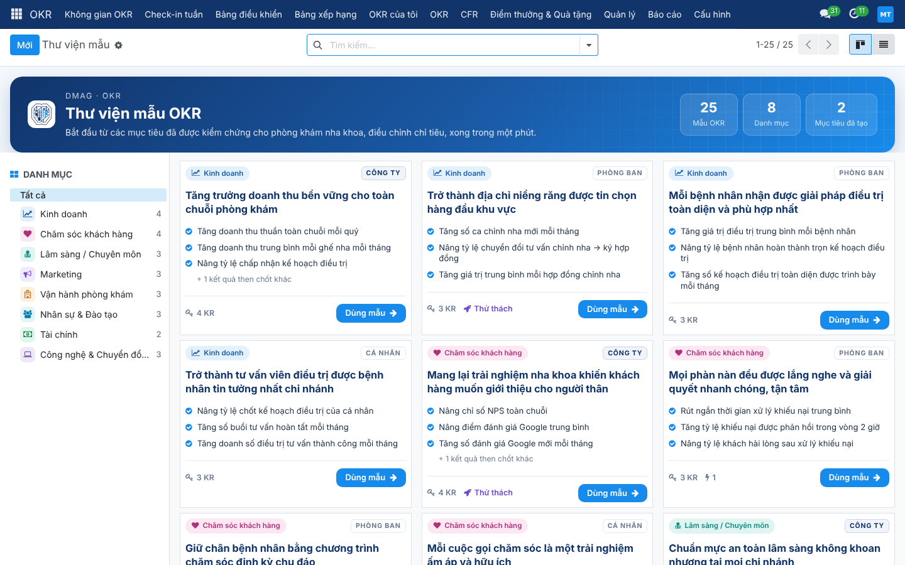
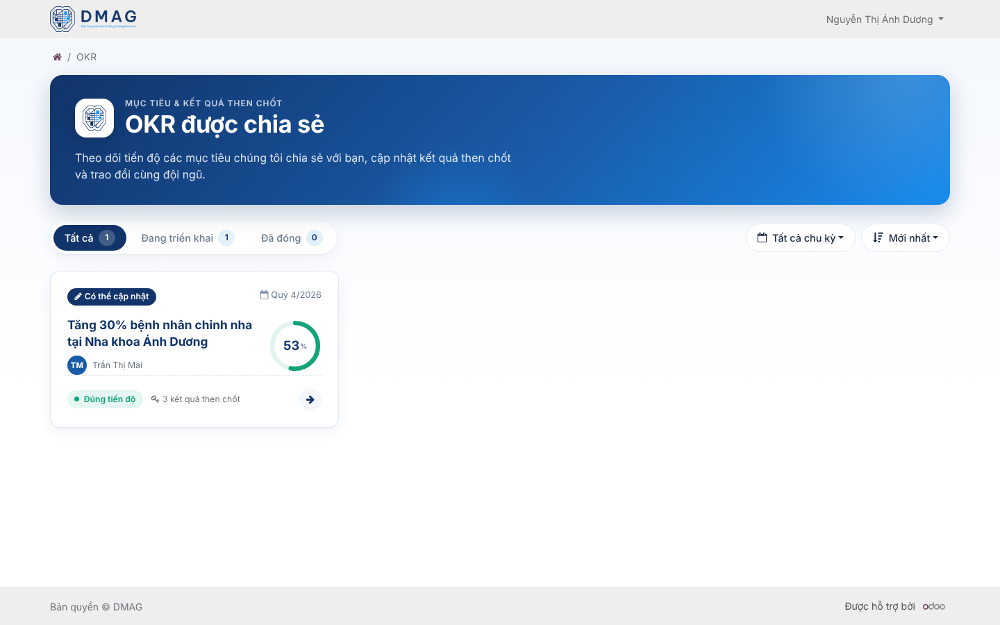

# OKR Scale – bộ module OKR cho Odoo 17 Community

Bộ add-on quản trị mục tiêu theo OKR (Objectives & Key Results) cho Odoo 17
Community, dựng mới từ đầu, tách module để cài đặt và nâng cấp độc lập.

| Module | Chức năng | Phụ thuộc |
|---|---|---|
| `okr_scale` | Lõi: chu kỳ, mục tiêu 3 cấp (màn hình riêng Công ty / Phòng ban / Cá nhân), KR có người chịu chính và bên hỗ trợ, căn chỉnh, **check-in tuần chiều thứ 6** và bảng đội, biểu đồ tiến độ thực tế vs kỳ vọng, duyệt, chấm điểm, phân quyền theo sơ đồ tổ chức, Không gian OKR, Dashboard với khu "Vấn đề cần xử lý", Bảng xếp hạng, email + thông báo Odoo (nhắc check-in, bản tin thứ Hai) | `hr`, `mail`, `web_hierarchy` |
| `okr_scale_project` | Liên kết KR với Dự án / Nhiệm vụ, tiến độ KR tự đồng bộ từ nhiệm vụ | `okr_scale`, `project` |
| `okr_scale_cfr` | CFR: Trao đổi 1:1 gắn với OKR (tổng quan KR, check-in từ buổi trước, lịch định kỳ, tự nhắc khi tự tin thấp), Phản hồi minh bạch, Bảng ghi nhận / lời khen, Giá trị cốt lõi | `okr_scale`, `calendar` |
| `okr_scale_template` | Thư viện OKR mẫu cho nha khoa (25 mẫu, 8 nhóm), dùng mẫu / lưu thành mẫu | `okr_scale` |
| `okr_scale_demo` | Dữ liệu demo DMAG để chạy thử (sơ đồ tổ chức, OKR, lịch sử check-in, 1:1, lời khen, quà, khách hàng portal) | tất cả module trên |
| `okr_scale_review` | Đánh giá giữa kỳ & tổng kết cuối chu kỳ: điểm theo cấp và phòng ban, cam kết vs thử thách, bài học, chuyển KR chưa xong sang chu kỳ sau | `okr_scale` |
| `okr_scale_reward` | Điểm thưởng (sổ cái), ngân sách tặng điểm hàng tháng, điểm tự động, Cửa hàng đổi quà | `okr_scale_cfr`, `product` |
| `okr_scale_reward_stock` | Quản lý quà tặng qua Kho: sản phẩm lưu kho, phiếu xuất khi duyệt đổi quà, cho phép đặt trước khi chưa có hàng | `okr_scale_reward`, `stock` |
| `okr_scale_portal` | Chia sẻ OKR cho từng tài khoản portal (khách hàng B2B) với quyền Chỉ xem / Có thể cập nhật, như Project | `okr_scale`, `portal` |
| `dmag_brand_theme` | Màu nhận diện DMAG cho toàn bộ giao diện Odoo (tùy chọn) | `web` |

## Hình ảnh

| | |
|---|---|
|  |  |
|  |  |
|  |  |
|  |  |
|  |  |

## Chạy thử trên máy (localhost) bằng Docker

Cần cài [Docker Desktop](https://www.docker.com/products/docker-desktop/) (Windows / macOS) hoặc Docker Engine (Linux), và bật Docker lên.

```bash
git clone -b claude/blissful-euler-lc78sp https://github.com/tsvinh7-ux/OKR-scale.git
cd OKR-scale
docker compose up -d
```

- **Lần đầu** mất khoảng 2–4 phút: hệ thống tự tạo database `dmag_okr`, cài toàn bộ module và dữ liệu demo DMAG.
  Theo dõi bằng `docker compose logs -f odoo`, khi thấy dòng `Odoo is starting on http://localhost:8069` là xong.
- Mở <http://localhost:8069>, đăng nhập `admin` / `admin`.
- Windows: có thể bấm đúp `start.bat`. macOS / Linux: `make start`.

| Tài khoản | Mật khẩu | Vai trò |
|---|---|---|
| `admin` | `admin` | Phó TGĐ, quản trị OKR |
| `ceo@dmag.vn` | `dmag2026` | Tổng giám đốc |
| `kinhdoanh@dmag.vn` | `dmag2026` | Trưởng phòng Kinh doanh (xem bảng check-in của đội) |
| `nv.kinhdoanh1@dmag.vn` | `dmag2026` | Nhân viên Kinh doanh |
| `anhduong.giamdoc@demo.vn` | `dmag2026` | Khách hàng portal, quyền cập nhật (mở <http://localhost:8069/my/okrs>) |
| `anhduong.ketoan@demo.vn` | `dmag2026` | Khách hàng portal, chỉ xem |

Các lệnh khác:

| Việc | Lệnh | Windows / make |
|---|---|---|
| Chạy toàn bộ kiểm thử tự động (database tạm, tự xoá) | `docker compose run --rm tests` | `run-tests.bat` / `make test` |
| Cập nhật sau khi `git pull` | `OKR_UPDATE=1 docker compose up -d --force-recreate odoo` | `make update` |
| Dừng | `docker compose down` | `make stop` |
| Xoá sạch và làm lại từ đầu | `docker compose down -v` rồi `docker compose up -d` | `make reset` |

Kiểm thử tự động cũng chạy trên GitHub Actions (`.github/workflows/tests.yml`) trong đúng image `odoo:17.0`
sau mỗi lần push: cài toàn bộ module, chạy kiểm thử và cài thử dữ liệu demo.

## Cài đặt

1. Thêm thư mục repo vào `addons_path` của Odoo 17.
2. *Ứng dụng > Cập nhật danh sách ứng dụng*, tìm **OKR Scale** và cài các module cần dùng.
3. Bật tiếng Việt: *Thiết lập > Ngôn ngữ* (các module có sẵn bản dịch `vi`).

## Phát triển & kiểm thử

```bash
odoo-bin -c odoo.conf -d test_okr -i okr_scale,okr_scale_project,okr_scale_cfr,okr_scale_reward,okr_scale_reward_stock,okr_scale_portal,okr_scale_template,okr_scale_review \
  --test-tags /okr_scale,/okr_scale_project,/okr_scale_cfr,/okr_scale_reward,/okr_scale_reward_stock,/okr_scale_portal,/okr_scale_template,/okr_scale_review --stop-after-init
```

Nguyên tắc để dễ nâng cấp lên Odoo 18/19: chỉ dùng kế thừa chuẩn (`_inherit`,
XPath, OWL registry), không sửa core Odoo; các module mở rộng gắn vào lõi qua
các hook có sẵn (`_compute_progress_by_method`, `_notify_checkin_due`,
`okr.scale.dashboard._get_extra_kpis / _get_extra_sections`).
